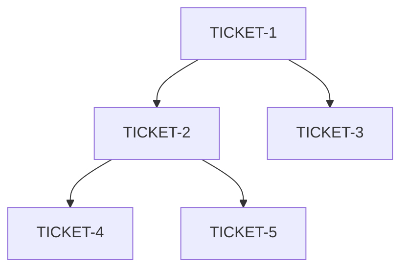

# Ticket Breakdown — Trading Journal & Analytics (MVP)

## Epic summary
Costruire un Trading OS a €0 per aspiranti trader funded (Futures NQ/ES) con feedback matematico (MAE/MFE/R-Multiple) per eliminare i leak emotivi.

## Tickets
### TICKET-1 — Setup Database
*   **Scope:** Creare lo schema PostgreSQL in Supabase (tabelle `users`, `trading_accounts`, `instruments`, `trades`, `executions`).
*   **Context:** `architecture.md` (Data Model).
*   **Files:** `db/schema.sql`.
*   **Depends on:** `<none>`.

### TICKET-2 — Core Engine (P&L, R, MAE/MFE)
*   **Scope:** Implementare l'engine matematico deterministico (P&L, R-Multiple, MAE, MFE) nel backend.
*   **Context:** `architecture.md` (Key Decisions).
*   **Files:** `lib/trading-engine.ts`.
*   **Depends on:** TICKET-1.

### TICKET-3 — CSV Import (Generic)
*   **Scope:** Parser CSV generico che mappa colonne variabili su standard interno.
*   **Context:** `architecture.md` (Missing Pieces).
*   **Files:** `lib/csv-import.ts`.
*   **Depends on:** TICKET-1.

### TICKET-4 — Dashboard (KPI + Equity Curve)
*   **Scope:** Dashboard con KPI (P&L, Win Rate, Profit Factor) e Equity Curve per NQ/ES.
*   **Context:** `architecture.md` (Stack: Next.js, shadcn/ui).
*   **Files:** `app/dashboard/page.tsx`.
*   **Depends on:** TICKET-2.

### TICKET-5 — Analytics Engine (Tag Correlation)
*   **Scope:** Engine che confronta trade con tag (es. FOMO) vs. untagged e mostra l'impatto P&L.
*   **Context:** `architecture.md` (Approach: Server-Side Analytics).
*   **Files:** `lib/analytics-engine.ts`.
*   **Depends on:** TICKET-2.

## Dependency graph

## Suggested execution order
*   **Wave 1 (Parallel):** TICKET-1, TICKET-3
*   **Wave 2:** TICKET-2 → TICKET-4, TICKET-5
